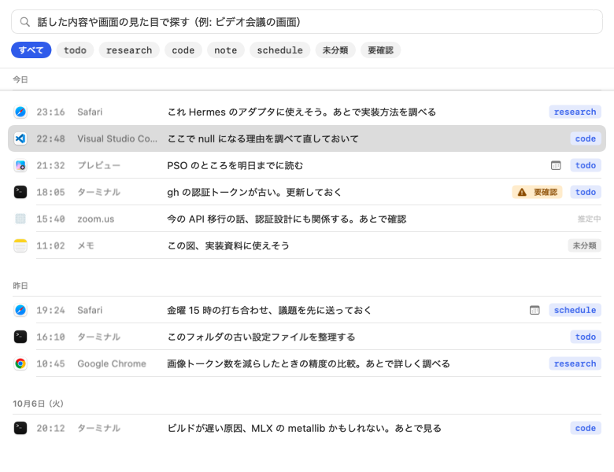
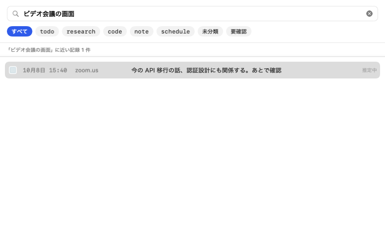

# Context Capture

**今見ている画面に、声でひと言メモを貼る macOS アプリ。**

`⌥Space` を押して、話して、離すだけ。スクリーンショット・アプリ名・ウインドウタイトル・URL・文字起こしをひとつの記録にまとめて Mac に保存します。あとから Inbox で探して手直しし、Claude Code や Hermes などの AI エージェントへ MCP で渡せます。

[Web サイト](https://ysogabe.github.io/memo-collector/) · [Issues](https://github.com/ysogabe/memo-collector/issues) · [Releases](https://github.com/ysogabe/memo-collector/releases) · [MIT License](LICENSE)



> 開発中のソフトウェアです。現在はソースからのビルドに対応しており、一般向けに署名・公証した配布版はまだありません。掲載画像は実アプリの UI に紹介用のサンプルデータを表示したものです。

## 主な機能

- **画面と声をまとめて記録** — ホットキーを押している間だけ録音し、前面ウインドウのスクリーンショットと文字起こしを保存。URL などが取れなくても記録を残します。
- **Inbox で整理・検索** — 注釈の編集、意図ラベルの修正、完了・アーカイブに対応。話した内容と画面の見た目を使って自然文で検索できます。
- **ローカルで処理** — 文字起こし、意図の推定、検索、秘密情報のチェックを Mac 上で実行します。モデルの初回取得にはインターネット接続が必要です。
- **共有前に画像を確認** — スクリーンショット内の API キーやトークンなどを検出し、「要確認」を表示。検出箇所を確認し、マスクした画像を使えます。
- **MCP でエージェントと連携** — 記録の一覧・検索・詳細取得、メモの追記、完了・アーカイブをローカル MCP サーバーから操作できます。

## 画面

Inbox では意図ラベルや「要確認」で絞り込めます。たとえば「ビデオ会議の画面」のように、画面の内容を手がかりに検索できます。



[画面ギャラリー](https://ysogabe.github.io/memo-collector/screens.html)では、記録の詳細・秘密情報の確認・設定も紹介しています。画像の出典は [screenshots.json](lp/assets/screenshots.json) を参照してください。検索画像はサンプル表示で、検索精度を示すものではありません。

## 動作環境

- Apple Silicon Mac、macOS 15 以降
- メモリ 16GB 以上を推奨（開発・実測環境は M3・24GB。各構成での動作確認は継続中）
- モデル用に約 5.3GB のディスク容量（初回の取得・変換時は一時的に約 13GB の空きが必要）

## ビルドと起動

開発には Xcode、XcodeGen、Metal Toolchain が必要です。開発環境は Xcode 27 / Swift 6.4 です。

```sh
git clone https://github.com/ysogabe/memo-collector.git
cd memo-collector
brew install xcodegen
xcodebuild -downloadComponent MetalToolchain
(cd app && xcodegen generate)
open app/ContextCapture.xcodeproj
```

Xcode で `ContextCapture` ターゲットの **Signing & Capabilities** を開き、自分の開発用 Team を選択してください。`ContextCapture` スキームと実行先の Mac を選び、Run（`⌘R`）で起動します。署名設定は開発者の Team が既定のため、継続してビルドする場合は [`app/project.yml`](app/project.yml) の `DEVELOPMENT_TEAM` も自分の Team ID に変更してください。

初回起動では、案内に従ってマイク・画面収録・アクセシビリティの権限とモデルを準備します。対応ブラウザから URL を取得するときは、オートメーションの許可も求められます。準備後、記録したい画面で `⌥Space` を押したまま話し、離すと保存されます。

## エージェントとの連携

付属の `cc-mcp` をビルドし、利用するエージェントの MCP 設定に登録します。

```sh
cd Packages/ContextCaptureKit
swift build --disable-keychain -c release --product cc-mcp
```

利用できるツールは `list_inbox`、`search_captures`、`get_capture`、`add_note`、`mark_done`、`archive` の 6 つです。接続方法は [MCP の設定・確認手順](docs/manual-tests/mcp.md) を参照してください。

## データとプライバシー

記録は既定で `~/Library/Application Support/ContextCapture/` に保存します。アプリの文字起こし・分類・検索では、音声やスクリーンショットを外部へ送信しません。

MCP で読み出した記録は、接続したエージェントの設定に従って外部サービスへ送信される場合があります。チェック中・要確認の画像は MCP に渡しませんが、注釈や URL などのテキストは別に返ります。秘密情報の検出には限界があるため、共有する内容を確認してください。

## 開発・コントリビューション

バグ報告・機能提案は [Issues](https://github.com/ysogabe/memo-collector/issues)、修正は Pull Request で受け付けています。バグ報告には macOS・Mac の構成と再現手順を添えてください。記録やログを共有する際は、個人情報・秘密情報を除いてください。

署名設定を自分の Team に変更したうえで、リポジトリのルートから次を実行すると、Swift パッケージとアプリのビルド・テストをまとめて確認できます。

```sh
scripts/check.sh
```

モデルが必要なテストは、モデルがない場合はスキップされます。

設計や検証の詳細は、以下の資料を参照してください。

- [プロダクト仕様](docs/prd/PRD.md)
- [PoC の再現手順](poc/README.md)・[検証結果](docs/poc/poc-report.md)
- [検索の評価手順](evals/search/README.md)

## ライセンス

[MIT License](LICENSE)。依存ライブラリ・モデル・第三者由来のデータには、それぞれのライセンスが適用されます。
